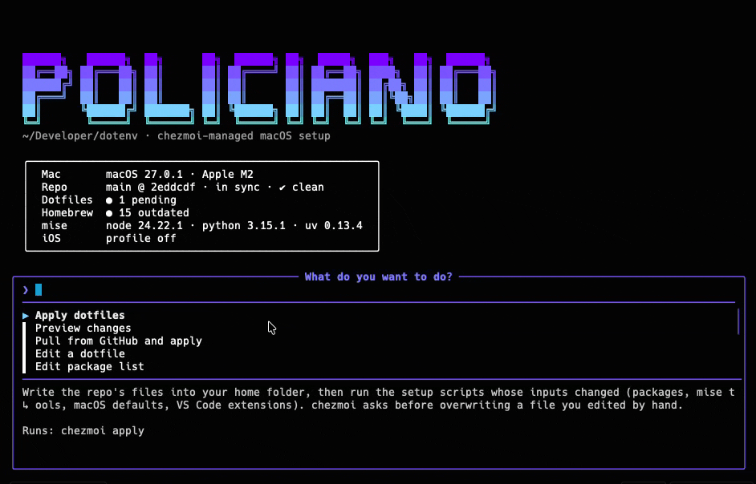

# dotenv

My macOS setup, managed by [chezmoi](https://chezmoi.io). One command takes a fresh Mac to a working machine,
and `make` opens an interactive menu to manage it afterwards.



## Fresh Mac

```sh
bash -c "$(curl -fsSL https://raw.githubusercontent.com/willwfsp/dotenv/main/install.sh)"
```

Use `bash -c "$(curl ...)"`, not `curl ... | bash`: the script prompts for things (Homebrew's sudo password,
chezmoi questions), and a pipe would swallow your keyboard input.

`install.sh` installs the Command Line Tools and Homebrew, clones this repo to `~/Developer/dotenv` and
installs chezmoi. Then it runs `chezmoi init --apply`, which:

1. asks for your name, email and whether to enable the iOS profile
2. installs the Homebrew packages (`home/.chezmoidata/packages.yaml`)
3. writes the dotfiles into `$HOME`
4. installs mise tools, applies macOS defaults and installs VS Code extensions

Finally it logs you into GitHub with `gh` (browser). Git uses HTTPS with gh's credentials, so this Mac
needs no SSH key for GitHub, at the desk or over a remote session.

Then, optionally:

- **Xcode** (iOS profile only): `make xcode` to pick and install a version.
- **Remote access:** see below.

The repo always lives in `~/Developer/dotenv`. The script uses it if it's already there, otherwise clones
it there, no matter which folder you run it from. Every step is skipped when already done, so it's safe to
run again. Set `DOTFILES_REPO=<user>/<repo>` to
install from a fork.

<details>
<summary>If the repo is private</summary>

The one-liner can't download from a private repo. Authenticate first:

```sh
xcode-select --install                     # wait for it to finish
/bin/bash -c "$(curl -fsSL https://raw.githubusercontent.com/Homebrew/install/HEAD/install.sh)"
eval "$(/opt/homebrew/bin/brew shellenv)" && brew install gh && gh auth login && gh auth setup-git
gh repo clone willwfsp/dotenv ~/Developer/dotenv && make -C ~/Developer/dotenv install
```
</details>

## Day to day

Run `make` for the interactive menu: a status panel (repo, pending dotfile changes, outdated packages,
mise tools) and every action below. A help panel explains the highlighted option and shows the command it
runs. Type to filter, Enter to run, Esc to quit. It uses [fzf](https://github.com/junegunn/fzf) and
[gum](https://github.com/charmbracelet/gum), and prints the plain target list when there's no terminal
(scripts, AI agents).

| Command | What it does |
|---|---|
| `make` | Interactive menu |
| `make diff` | Preview changes before applying |
| `make apply` | Apply the repo to `$HOME` |
| `chezmoi edit ~/.config/zsh/.zshrc` | Edit a managed file (source and target) |
| `chezmoi re-add` | Pull changes an app made to a managed file (VS Code, Warp, Claude) back into the repo |
| `make ios` | Turn on the iOS profile (xcodes, aria2, Tuist) |
| `make doctor` | Health checks |

## Layout

```
install.sh, Makefile, scripts/   bootstrap and helpers (not copied to $HOME)
home/                            chezmoi source state (.chezmoiroot)
  .chezmoidata/                  package and extension lists
  dot_config/zsh/                zsh: .zshenv, .zprofile, .zshrc, plugins, functions/, conf.d/
  dot_config/{git,gh,mise}/      tool configs
  dot_claude/                    global Claude Code config
  run_onchange_*                 scripts that re-run when their inputs change
```

### Zsh

- `~/.zshenv` only sets `ZDOTDIR=~/.config/zsh`.
- `.zshenv` (every shell, including scripts and AI agents) sets env vars and PATH. It stays fast and prints nothing.
- `.zshrc` (interactive shells only) loads history, plugins via antidote (`.zsh_plugins.txt`), fzf, mise and starship.
- Functions: one file per function in `functions/`, autoloaded on first use.
- Aliases and small snippets: `conf.d/*.zsh`.

## Remote access

SSH into this Mac with a key from the device you connect *from* (ideally stored in that device's 1Password).

1. Copy that device's public key (`ssh-ed25519 AAAA...`, without the trailing comment) into
   `home/.chezmoidata/ssh.yaml`, then `make apply`. That writes `~/.ssh/authorized_keys`.
2. `make remote-access` turns on Remote Login and switches sshd to key-only (no passwords, no root
   login). It refuses to run while `authorized_keys` is empty.

Worth knowing for a headless Mac:

- **From outside home:** [Tailscale](https://tailscale.com) gives the Mac a stable private address without
  opening router ports (`brew install --cask tailscale`, or add it to `packages.yaml`).
- **FileVault and reboots:** after a reboot the disk stays locked, and SSH is unavailable until someone logs
  in at the Mac. Use `sudo fdesetup authrestart` for planned reboots; a power cut needs someone at the
  keyboard (or a UPS).

## Before resetting this Mac

- [ ] Make sure every project in `~/Developer` is pushed.
- [ ] Back up anything else you want from `~/Documents`, `~/Desktop` and `~/Downloads`.
